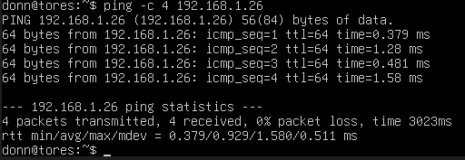
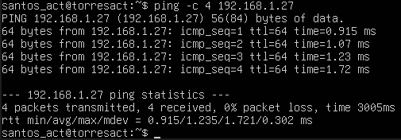

# Ubuntu Server Connectivity Test

## Overview

A practical networking lab using two Ubuntu Server virtual machines running on a single laptop through Oracle VirtualBox. The lab focused on troubleshooting network connectivity, configuring DHCP through Netplan, and verifying communication between the two virtual machines.

## Environment

- **Operating System:** Ubuntu Server
- **Virtualization:** Oracle VirtualBox
- **Host Device:** One laptop
- **Virtual Machines:** Two Ubuntu Server VMs
- **Network Modes Tested:** NAT and Bridged Adapter
- **Connectivity Tests:** `ping`

## Troubleshooting Process

### Problem

The first Ubuntu Server VM could not ping `8.8.8.8`, returning a network unreachable error.

### Steps Taken

1. Switched the VirtualBox network adapter from Bridged Adapter to NAT.
2. Retested connectivity using `ping 8.8.8.8`, but the network unreachable error persisted.
3. Opened the Netplan configuration file:

   ```bash
   sudo nano /etc/netplan/00-installer-config.yaml
   ```

4. Discovered that the configuration was missing `dhcp4: true`.
5. Added `dhcp4: true` under the appropriate network interface configuration.
6. Saved the changes using `Ctrl + O`, pressed `Enter`, and exited using `Ctrl + X`.
7. Applied the updated configuration:

   ```bash
   sudo netplan apply
   ```

8. Retested `ping 8.8.8.8` and confirmed that connectivity was working.
9. Switched the VirtualBox network adapter back to Bridged Adapter and confirmed that ping connectivity still worked.

### Second Virtual Machine

The second Ubuntu Server VM initially encountered the same connectivity issue. I repeated the troubleshooting process, added the missing DHCP configuration, and applied the changes. The second VM could then successfully ping `8.8.8.8`.

## VM-to-VM Connectivity Test

After resolving the network configuration issues, I tested communication between the two Ubuntu Server VMs using their assigned IP addresses.

- **VM 1 → VM 2:** Successful ping replies received.
- **VM 2 → VM 1:** Successful ping replies received.

These tests confirmed that both virtual machines could communicate with each other over the configured virtual network.

## Results

- Identified and corrected missing DHCP configuration in both VMs.
- Restored connectivity to the external IP address `8.8.8.8`.
- Successfully tested communication between the two Ubuntu Server VMs in both directions.
- Gained practical experience with Netplan, DHCP, VirtualBox networking, and Linux network troubleshooting.

## Evidence




## Key Takeaway

This lab provided hands-on experience diagnosing Linux network connectivity problems, modifying Netplan configuration, applying network changes, and verifying both external connectivity and communication between virtual machines.