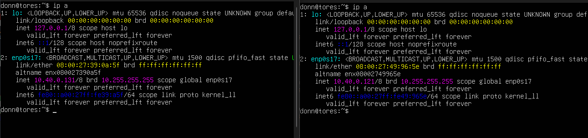
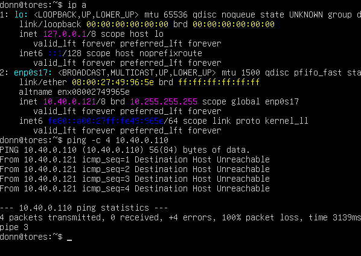
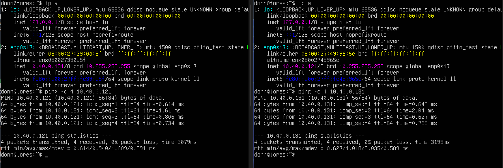

# Ubuntu Server Internal Network

## Overview

A networking lab using two Ubuntu Server virtual machines on an Internal Network in Oracle VirtualBox. Unlike the previous connectivity test, there is no DHCP server on an internal network, so both VMs were given static IP addresses through Netplan manually. This lab also involved troubleshooting a wrong interface name in the Netplan file, then verifying communication between the two VMs with `ping`.

## Environment

- **Operating System:** Ubuntu Server
- **Virtualization:** Oracle VirtualBox
- **Host Device:** One laptop
- **Virtual Machines:** Two Ubuntu Server VMs (the second cloned from the first)
- **Network Mode:** Internal Network (same network name on both VMs)
- **Connectivity Tests:** `ping`

## Network Configuration (Set B)

| Setting     | VM 1                      | VM 2                      |
| ----------- | ------------------------- | ------------------------- |
| IP Address  | `10.40.0.121/8`           | `10.40.0.131/8`           |
| Class       | A (`255.0.0.0`)           | A (`255.0.0.0`)           |
| Gateway     | `10.40.0.1`               | `10.40.0.1`               |
| DNS         | `10.40.0.51`, `10.40.0.91` | `10.40.0.51`, `10.40.0.91` |
| Network     | Internal Network          | Internal Network          |

## Configuration Process

1. Opened the first VM and edited the Netplan file:

   ```bash
   sudo nano /etc/netplan/00-installer-config.yaml
   ```

2. Found the default configuration with `dhcp4: true`, removed it, and replaced it with the static Set B configuration:

   ```yaml
   network:
     version: 2
     ethernets:
       enp0s3:
         dhcp4: false
         addresses:
           - 10.40.0.121/8
         routes:
           - to: default
             via: 10.40.0.1
         nameservers:
           addresses:
             - 10.40.0.51
             - 10.40.0.91
   ```

3. Saved the file and applied it:

   ```bash
   sudo netplan apply
   ```

4. Cloned the VM and set both VMs to the same Internal Network.
5. On the second VM, changed the address to `10.40.0.131/8` and applied it again with `sudo netplan apply`.

## Troubleshooting Process

### Problem

After configuring both VMs, `ip a` showed no IP address at all on either one, and `ping` to the other VM failed.

### Steps Taken

1. Ran `ip a` and noticed the interface had no IPv4 address.
2. Rechecked the interface name in the `ip a` output and found it was `enp0s17`, not `enp0s3`. Netplan was configuring an interface that did not exist, so nothing was applied.
3. Corrected the interface name in the Netplan file on both VMs:

   ```bash
   sudo nano /etc/netplan/00-installer-config.yaml
   sudo netplan apply
   ```

4. Ran `ip a` again and confirmed both VMs now had their static IP addresses.



## Connectivity Tests

### Negative Test

From VM 1, pinged an IP address that does not exist on the network:

```bash
ping -c 4 10.40.0.110
```

**Result:** No replies, as expected, which shows the ping test only succeeds when a real host is on the other end.



### VM-to-VM Test

```bash
ping -c 4 10.40.0.131   # from VM 1
ping -c 4 10.40.0.121   # from VM 2
```

- **VM 1 → VM 2:** Successful ping replies received.
- **VM 2 → VM 1:** Successful ping replies received.



## Results

- Replaced the default DHCP configuration with a static Class A configuration on both VMs.
- Found and fixed a wrong interface name (`enp0s3` vs. `enp0s17`) in the Netplan file.
- Confirmed that a ping to a non-existent IP fails.
- Confirmed that both Ubuntu Server VMs can reach each other over the Internal Network.

## Key Takeaway

Always check the real interface name with `ip a` before writing a Netplan file, because a wrong name fails silently and leaves the interface with no address. An Internal Network also has no DHCP server, so static addressing is required, and the gateway and DNS servers do not exist in this lab. The pass condition is communication between the two VMs.